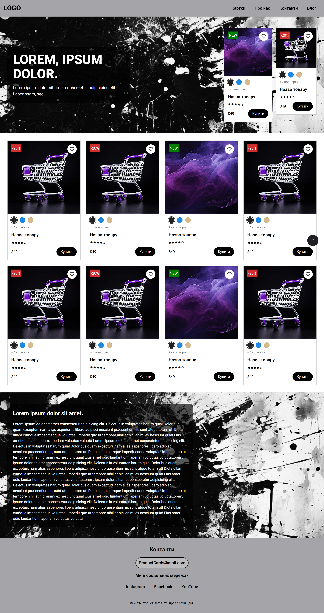
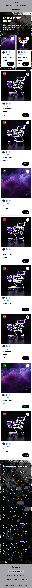

# Домашнє завдання №7 — Сторінка інтернет-магазину

Адаптивна сторінка магазину, створена за макетом у Figma та стилізована за допомогою CSS.

**Демо:** https://sandal01k.github.io/my-web-course/hw-07/index.html
**Макет:** [Figma](https://www.figma.com/design/YappZa894fTb1vxLR8OYWh/Free-eCommerce-Product-Cards--Community-?node-id=0-1&p=f&t=JMgqkkPiPSO0yuLC-0)

## Технології

- HTML5, CSS3
- Шрифт Roboto
- Flexbox
- Grid
- Responsive Design

## Основні особливості

- Кольорова палітра з макету, доповнена контрастними кольорами для доступності
- Зображення експортовано з макету та оптимізовано
- Адаптивність:
  - десктоп — від 1024px
  - планшети — до 1023px
  - смартфони — до 767px

## Перевірка якості

- HTML перевірено через [W3C Validator](https://validator.w3.org/)
- Доступність перевірено через [WAVE](https://wave.webaim.org/) та Lighthouse
- Lighthouse: Accessibility 100%, Performance 99% (після оптимізації зображень)

## Скріншоти

## Запуск

Відкрийте `index.html` у браузері.
