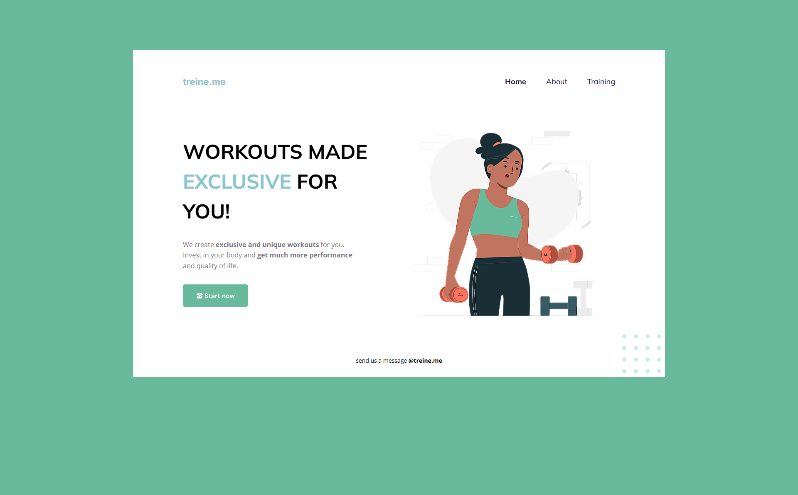
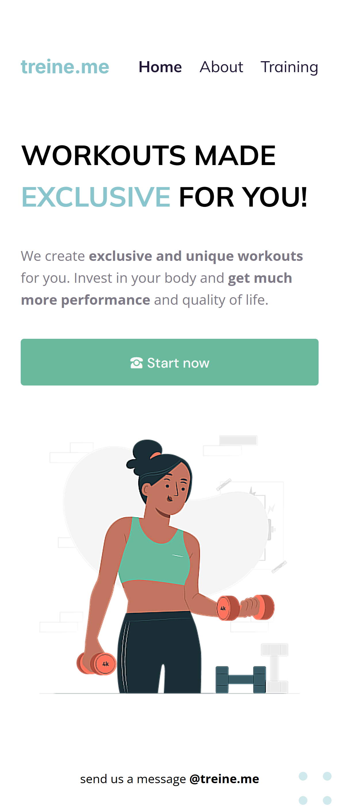

# treine.me

Навчальний лендінг фітнес-сервісу за макетом. Стек: HTML5 + CSS3.

**Демо:** https://sandal01k.github.io/my-web-course/hw-08/index.html
**Макет:** [Figma](https://www.figma.com/design/umJ2bg23CCt2JQhk79SJXT/Layout-to-study-HTML---CSS--Community-?node-id=1207-2&p=f&t=cduHiU7INmv0l2X0-0)

## Структура

```
index.html
style.css
images/hero-illustration.png
```

## Що реалізовано

- **Семантична розмітка:** `header`, `nav`, `main`, `footer`.
- **Шрифти (Google Fonts):** Mulish (заголовок, меню), Inter (лого), DM Sans (кнопка), Open Sans (основний текст, 400 і 700).
- **CSS-змінні** в `:root` для кольорів, `box-sizing: border-box` і скидання відступів.
- **Header:** Flexbox, підкреслення пунктів меню при наведенні (`::after` + `transform: scaleX()`), активний пункт виділений жирним.
- **Hero-секція:** Flexbox, текст ліворуч, зображення праворуч, CTA-кнопка з ефектом `scale` при наведенні та фокусі (`:focus-visible`).
- **Футер:** центрований текст і декоративний патерн із крапок (`radial-gradient`, `position: absolute` відносно `.wrapper`).
- **Адаптивність (`@media (max-width: 768px)`):** hero стає вертикальним (`flex-direction: column`), заголовок зменшується, кнопка на всю ширину, прибрана фіксована ширина макета.

## Резюме

- Кольори брались з макету але не у всіх випадках проходять перевірку на контрастність.
- HTML перевірено через [W3C Validator](https://validator.w3.org/)
- Доступність перевірено через [WAVE](https://wave.webaim.org/) та Lighthouse
- WAVE: помилки по контрасту в логотипі та HERO-секції
- Lighthouse: Accessibility 93%, Performance 100%

## Скріншоти




## Запуск

Відкрийте `index.html` у браузері.
